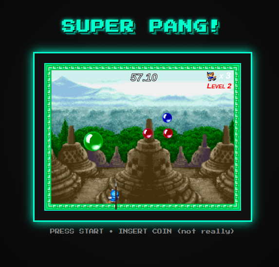
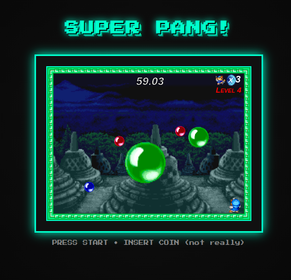

# Super Pang

This is an implementation of the classic **Super Pang** game for the web.

<!-- Main big screenshot -->
<p align="center">
  
</p>

<!-- Row of 3 smaller screenshots -->
<p align="center">
  
  
  
</p>

## How to Play

- Use the **arrow keys** to move the character.
- Press **space** to shoot.
- Try to clear all the levels before the time runs out!

## Installation

1. Clone the repository:
   ```bash
   git clone https://github.com/oihanealbizuri/SuperPang.git
   ```
2. Navigate to the project directory:
   ```bash
   cd SuperPang
   ```
3. Install the dependencies:
   ```bash
   npm install
   ```
4. Start the development server:
   ```bash
    npm start
    ```
5. Open your browser and go to `http://localhost:3000` to play the game.

## Technologies Used
- JavaScript (Vanilla)
- Howler.js for audio management
- HTML5 Canvas for game rendering
