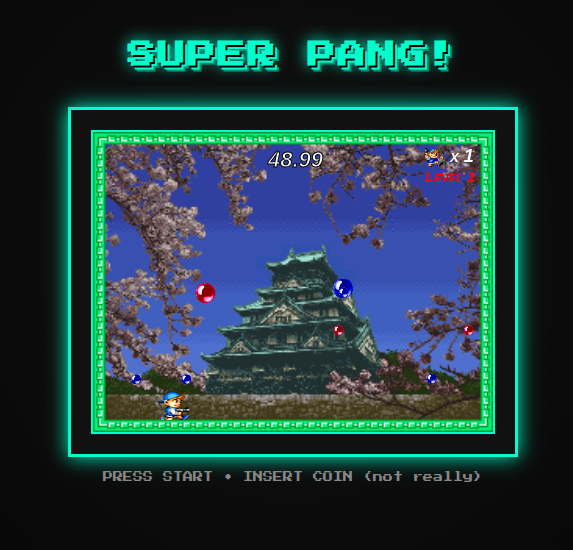
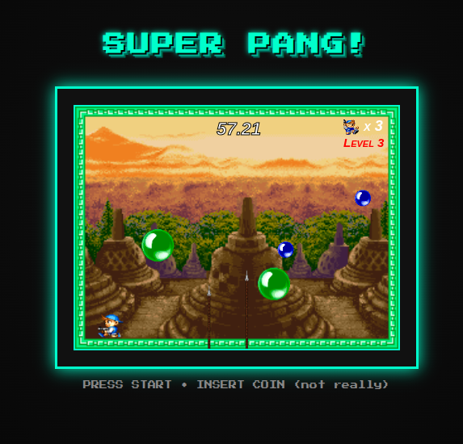

# Super Pang

This is an implementation of the classic **Super Pang** game for the web.

<!-- Main big screenshot -->
<div style="text-align: center; margin-bottom: 20px;">
  
</div>

<!-- Row of 3 smaller screenshots with hover glow -->
<div style="text-align: center;">
  
  
  
</div>

<!-- Hover glow CSS -->
<style>
  .level-thumb {
    width: 180px;
    border: 2px solid #00ffcc;
    border-radius: 5px;
    margin: 5px;
    transition: all 0.3s ease;
    box-shadow: 0 0 0 #00ffcc;
  }

  .level-thumb:hover {
    transform: scale(1.05);
    box-shadow: 0 0 15px #00ffcc, 0 0 30px #00ffcc;
  }
</style>

## How to Play

- Use the **arrow keys** to move the character.
- Press **space** to shoot.
- Try to clear all the levels before the time runs out!

## Installation

1. Clone the repository:
   ```bash
   git clone https://github.com/oihanealbizuri/SuperPang.git
   ```
2. Navigate to the project directory:
   ```bash
   cd SuperPang
   ```
3. Install the dependencies:
   ```bash
   npm install
   ```
4. Start the development server:
   ```bash
    npm start
    ```
5. Open your browser and go to `http://localhost:3000` to play the game.

## Technologies Used
- JavaScript (Vanilla)
- Howler.js for audio management
- HTML5 Canvas for game rendering
